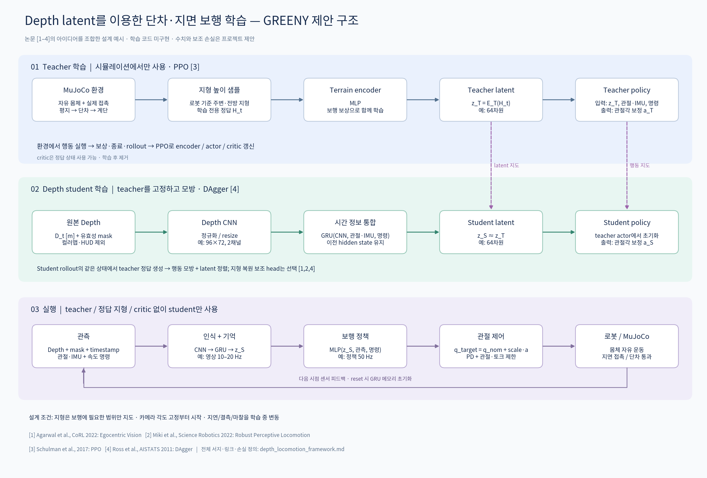

# Depth latent 기반 단차·지면 보행: 설계 예시

이 문서는 학습 프레임워크의 제안이며 구현 완료 보고가 아니다. 도식은 아래 논문 [1–4]에서 가져온 아이디어를 현재 RoughTerrain 모델에 맞게 조합한 것으로, 특정 논문 그림의 복제가 아니다. 네트워크 크기, 주기, 손실의 조합과 단계별 구현 범위는 프로젝트 제안이다.



확대·공유용: [SVG](depth_locomotion_framework.svg), [PDF](depth_locomotion_framework.pdf).
재생성: 저장소 루트에서 `python greeny/docs/draw_depth_framework.py` (Matplotlib 및 Noto CJK 폰트 필요).

## 1. 목표와 적용 범위

초기 목표는 평지, 작은 단차 오르기/내리기, 완만한 경사, 연속 계단과 불규칙 지면에서 명령 속도를 따라 안정적으로 걷는 것이다. 초기 실험에서는 카메라 각도와 로봇 형태를 고정하고, bipedal과 quadrupedal 정책은 별도로 학습한다. 형태 전환, 능동 카메라 제어, 점프와 큰 갭 통과는 초기 범위에 포함하지 않는다.

권장 접근은 시뮬레이터에서 얻는 저비용 지형 높이 샘플로 teacher를 먼저 학습하고, 원본 depth와 자기 상태 이력을 사용하는 recurrent student로 옮기는 것이다. [1]은 전방 depth, proprioception, 기억 모듈을 사용한 단차·계단 보행과 teacher/student 학습의 직접적인 선행 연구다. [2]에서는 recurrent belief와 지형 복원 보조 학습 아이디어를 참고한다. 단, [2]의 실제 입력은 depth 원영상이 아니라 elevation map에서 추출한 높이 샘플이다. 두 논문은 quadruped 결과이며 bipedal 성공을 보장하지 않는다.

## 2. 관측과 제어 계약

| 신호 | 예시 계약 | 주의점 |
|---|---|---|
| 원본 depth D | 카메라 전방축 깊이, float32, m | 화면의 RGB 컬러맵/문자는 학습 입력이 아니다. |
| 유효성 M | 유효 1, 미측정 0 | NaN을 모델에 넣지 않는다. 유한한 대체값과 mask를 함께 사용한다. |
| 영상 전처리 | 640×480 → 96×72, depth+mask의 2채널 | 예시값이다. 종횡비를 유지하고 결측을 섞어 평균내지 않는다. 학습과 실행의 crop·좌표계·정규화를 일치시킨다. |
| p_t | q, dq, 몸체 각속도, 몸체 좌표계의 중력 방향, 이전 action | 실제로 얻을 수 있는 신호만 student에 넣는다. 선속도를 넣으려면 실기에서도 동작하는 추정기가 필요하다. |
| c_t | vx, vy, yaw rate 명령 | 단차 접근 속도부터 제한해 학습한다. |
| camera metadata | timestamp, image age, 새 프레임 여부; 가동 시 CAM_J 각도 | 초기에는 모델별 장착 자세 고정. intrinsic/extrinsic은 실제 센서와 맞춰야 한다. |
| z_t | 64차원 terrain latent | 차원은 실험값. 각 요소가 높이·경사라는 명시적 의미를 갖는 것은 아니다. |
| action | 제어 대상 관절의 정규화된 각도 보정 a | q_target=q_nom+scale*a, 그 뒤 PD와 토크/관절 한계 적용. |

깊이의 멀어짐은 평평한 바닥에서도 발생한다. depth 숫자를 그대로 지면 높이로 취급하면 안 된다. 높이 복원 head를 사용할 때 정답 H는 중력 방향 z축을 갖는 로봇 중심/yaw 정렬 좌표계의 상대 지면 높이로 정의한다. roll/pitch에 따른 시야 변화를 구분하도록 proprioception을 함께 입력한다.

예시 실행 주기는 영상/CNN 10–20 Hz, GRU/정책 50 Hz이다. CNN feature는 새 영상이 올 때 갱신하고, GRU는 매 정책 tick에 최신 feature, p_t, image age/새 프레임 여부를 받는다. 실제 시간 간격에 맞춰 학습하고, 시뮬레이터 PD/물리 적분은 모델 안정성에 맞는 더 빠른 주기로 실행한다. 모든 주기는 시작점이며 측정 후 결정한다. Reset 및 병렬 환경별로 GRU hidden state를 따로 관리한다.

## 3. 학습 순서

### A. Teacher: 지형을 알고 걷는 정책

- 시뮬레이터의 지형 충돌 형상에서 주변·전방 높이 H_t를 샘플링한다. 바닥뿐 아니라 단차/계단 geom도 포함하고 로봇 자기 형상은 제외한다.
- z_T=E_T(H_t), a_T=pi_T(p_t,c_t,z_T). encoder와 actor를 PPO [3]로 함께 학습한다.
- critic에는 시뮬레이터의 실제 속도, 접촉, 마찰 등의 privileged state를 추가할 수 있다. 초기 actor에는 숨겨진 마찰이나 질량을 직접 넣지 않는다. 그래야 student가 맞출 수 없는 별도 latent를 요구하지 않는다.
- 보상은 명령 추종/단차 통과, 넘어짐·몸통 충돌 억제, 발 미끄러짐 억제, 토크/기계적 일과 action 변화 억제를 중심으로 조합한다. 발 들어올림 보조 보상은 과도한 발 높이/제자리 발구르기를 유도하지 않게 보행 phase와 연계할 때만 추가한다.
- 몸체 높이 보상은 단일 world-z 목표가 아닌 주변 지면 대비 높이로 정의한다. 높이만 유지하는 보상이 계단 오르기를 방해하지 않게 한다.
- teacher가 보는 지형 범위를 카메라가 지금 또는 최근에 볼 수 있는 영역과 맞춘다. 가려진 먼 지형/후방을 전지적으로 보고 행동하게 하면 student 증류가 불가능해질 수 있다.

### B. Student: 영상으로 teacher를 따라가는 정책

정규화된 depth와 mask를 CNN으로 처리하고, proprioception과 함께 GRU에 넣는다.

```
f_t = CNN(D_t, M_t)
h_t = GRU(f_latest, p_t, c_t, image_age, new_frame, h_(t-1))
z_S = Linear(h_t)
a_S = pi_S(p_t, c_t, z_S)
```

teacher encoder/actor는 고정한다. student actor는 teacher actor 가중치에서 초기화한다. 초기에는 actor를 고정하고 vision encoder/GRU를 학습한 다음, 행동 모방 오차를 줄이도록 student actor도 풀어 학습할 수 있다. teacher의 정답 latent는 고정된 좌표계가 되므로 latent MSE가 의미를 갖는다.

제안 손실:

```
L_student = lambda_a * mean(||a_S - stopgrad(a_T)||²)
          + lambda_z * mean(||z_S - stopgrad(z_T)||²)
          + lambda_h * masked_mean(||Decoder(z_S) - H_t||²)
```

마지막 지형 복원 항은 선택 사항이며 lambda_h=0으로 시작해 비교한다. 보행 동작을 모방하는 손실과 latent 정렬이 중심이다. Decoder는 학습 후 제거할 수 있다. 복원 정답은 관측 이력에서 추론 가능한 발 디딤 주변 지형에 제한한다. 손실별 스케일을 정규화하고 가중치는 검증으로 정한다.

teacher가 걸은 데이터만 사용하는 대신, student가 실제로 방문한 시뮬레이션 상태에서 teacher의 행동·latent를 질의해 데이터를 누적하는 DAgger [4] 방식을 사용한다. 두 정책의 정답은 동일 시점, 동일 상태, 동일 명령에서 비교한다. 순환 모델은 시퀀스 minibatch, hidden-state burn-in과 종료 mask를 사용한다. latent 오차가 작다는 것만으로 보행 성공을 판단하지 않는다.

### C. 실행 및 선택적 미세조정

실행에는 depth 전처리, CNN/GRU, student actor와 PD만 남긴다. teacher, critic, 정답 지형, 보조 decoder는 필요 없다. 실제 로봇과 동일한 입력 계약으로 MuJoCo 평가를 먼저 수행한다. 필요할 때 student를 시뮬레이션에서 PPO로 미세조정할 수 있지만 초기 필수 단계는 아니다.

## 4. 커리큘럼과 평가

1. 자유 몸체 평지에서 정지·속도 추종 보행.
2. 다리 가동 범위보다 충분히 작은 단일 단차, 낮은 접근 속도, 정면 진입.
3. 단차 높이·깊이·진입 각도와 위치를 무작위화하고 오르기/내리기를 분리 측정.
4. 연속 계단, 완만한 경사와 불규칙 지면을 섞기.
5. depth 지연·결측·노이즈와 마찰·질량·모터 강도·제어 지연의 변동을 추가.

특정 최대 단차 높이는 아직 지정하지 않는다. 실제 로봇의 발 크기, 관절 가동 범위, 토크와 접촉 설계에 맞춰 결정한다. 단차 통과는 몸통/후방 지지부까지 넘어가고 일정 시간 보행을 유지하는 것으로 정의한다. 실패는 넘어짐, 금지된 몸통 접촉, 관절 한계 위반, 시간 초과 등으로 정의한다.

비교 대상: (i) proprioception-only blind policy, (ii) teacher, (iii) depth student, (iv) GRU 없는 student. 별도로 latent 손실/복원 손실 제거 실험을 한다. 학습에 사용하지 않은 지형 seed와 높이/각도 조합에서 여러 trial/학습 seed로 성공률, 낙상률, 속도 추종 오차, 발 미끄러짐, 에너지와 추론 latency를 측정한다. 양발/네발 형태는 독립 평가한다.

## 5. 현재 저장소에서 추가할 경계

현재 구현은 학습용 센서/환경 인터페이스 전체가 아니라 렌더링과 depth 읽기의 기반이다.

- `runtime/depth_view.h`의 depth 벡터는 창 내부에 있다. raw-depth sensor를 GUI에서 분리해 RGB 컬러 변환 전의 metric depth, mask, timestamp, 카메라 metadata를 학습 환경에 전달해야 한다.
- 현재 RGB/depth 버퍼는 OpenGL의 아래 행부터 저장되는 순서다. 학습용 배열을 만들 때 위 행부터 시작하는 표준 이미지 순서로 한 번 변환하고 실행에서도 같은 계약을 사용한다.
- `joint-trajectory`는 root free joint를 제거하는 fixed-base 모드다. 학습 환경은 원본 free joint를 유지하고 인위적 몸체 지지력을 쓰지 않아야 한다.
- 기존 RL controller는 8개 관절을 전제로 한 배열을 사용한다. RoughTerrain의 28-actuator 계약과 곧바로 호환되지 않는다. bipedal 초기 예시는 양쪽 다리 12개 관절을 action으로 쓰고 나머지 관절은 고정 목표로 유지할 수 있다. quadrupedal은 실제 지지/구동에 참여할 관절 집합을 별도로 정의한다.
- `reset / step / observation / reward / termination` 환경 인터페이스, terrain generator, teacher용 지형 sampler, rollout buffer와 PPO/DAgger trainer가 필요하다.
- 병렬 환경, headless offscreen renderer의 처리량을 측정해야 한다. 현재 GLFW 창의 실시간 표시 속도를 학습 처리량으로 가정하지 않는다. Teacher 단계에서는 depth 렌더링을 생략할 수 있다.
- ONNX 내보내기 시 CNN/GRU hidden state, 입력 순서와 정규화, action scale, camera calibration, timestamp 계약까지 함께 저장한다.

## 6. 인용 논문 및 사용한 아이디어

[1] Ananye Agarwal, Ashish Kumar, Jitendra Malik, Deepak Pathak. **Legged Locomotion in Challenging Terrains using Egocentric Vision.** CoRL 2022. [논문](https://arxiv.org/abs/2211.07638), [전문](https://arxiv.org/html/2211.07638v1), [저자 프로젝트](https://vision-locomotion.github.io/).
참고: terrain-sample teacher → depth student, CNN/recurrent memory, 행동 또는 latent 증류. 본 제안의 가장 직접적인 출발점이다.

[2] Takahiro Miki, Joonho Lee, Jemin Hwangbo, Lorenz Wellhausen, Vladlen Koltun, Marco Hutter. **Learning robust perceptive locomotion for quadrupedal robots in the wild.** Science Robotics, 7(62), eabk2822, 2022. [논문](https://arxiv.org/abs/2201.08117), [DOI](https://doi.org/10.1126/scirobotics.abk2822).
참고: proprioception과 외부 지형 정보를 결합하는 recurrent belief, teacher/student, 복원 보조 손실. 원 논문은 elevation-map height samples를 사용하며 raw-depth CNN 논문으로 인용하지 않는다.

[3] John Schulman, Filip Wolski, Prafulla Dhariwal, Alec Radford, Oleg Klimov. **Proximal Policy Optimization Algorithms.** arXiv:1707.06347, 2017. [논문](https://arxiv.org/abs/1707.06347).
참고: teacher의 on-policy actor–critic 최적화 알고리즘. 특정 terrain encoder를 제안한 논문은 아니다.

[4] Stéphane Ross, Geoffrey Gordon, Drew Bagnell. **A Reduction of Imitation Learning and Structured Prediction to No-Regret Online Learning.** AISTATS 2011, PMLR 15:627–635. [논문 및 서지](https://proceedings.mlr.press/v15/ross11a.html).
참고: student가 유도하는 상태 분포에서 teacher label을 모아 학습하는 DAgger. 로봇 보행 전용 구조는 아니다.
